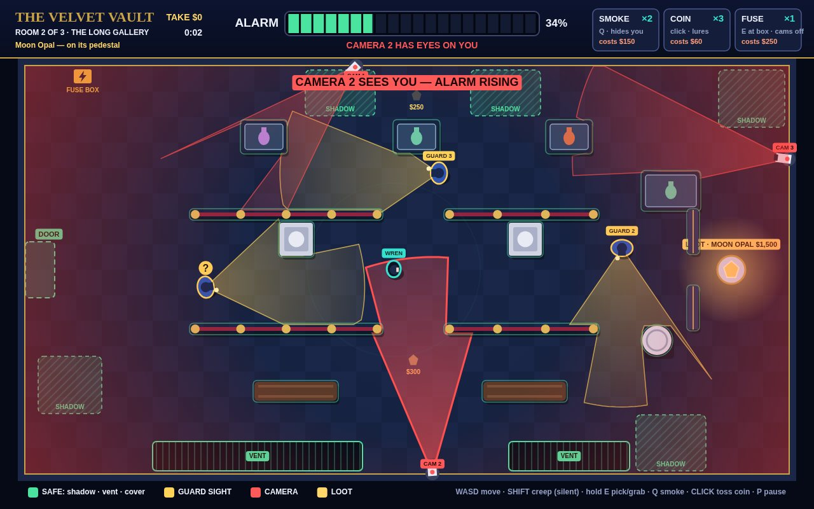

# The Velvet Vault

A top-down heist in three rooms, made for the [make.fun "Make the best heist game" bounty](https://make.fun/bounty/best-heist-game-20261122-0559). You are Wren, a thief in the Maison Verre at night. Case each room from the door, pick a route, lift the piece on the gold pedestal and get back out before the alarm fills.

## Play

Open `game/index.html` in desktop Chrome, or run `node serve.ts` and open http://localhost:8080. Static files, no build step, no network request, no asset outside `game/`.

| Key | What it does |
| --- | --- |
| WASD / arrows | move (running is fast and loud: guards in earshot turn to look) |
| Shift | creep: half speed, silent |
| hold E | work: pick the pedestal's lock (2.6 s), grab a side piece, pull the fuse |
| Q | smoke pellet: nobody sees into the cloud for 5.5 s ($150, two a room) |
| click | toss a coin: the nearest guard walks over to the clink ($60, three a room) |
| P / R / M | pause / case the room again / mute |

## How a room reads

- **Green is safe.** Shadows blind cameras completely and guards beyond arm's length; vents hide you from everyone but slow you down; solid cover cuts every sight cone short, and the cone you see drawn is exactly what the watcher sees.
- **Amber is a guard's eye, red is a camera's.** Guards walk rounds and stop at the ends to turn, which is when their cone sweeps; cameras pan on a rhythm.
- **Gold is loot.** The mark sits in an alcove you must reach; two side pieces in each room pay extra for a detour.
- **The alarm meter** forgives a glimpse: 0.8 s of "SPOTTED!" before it climbs, then it rises while you are watched and drains slowly once you break the line of sight. Full meter is a fair catch, and the room restarts at once.

## Three rooms, three routes each

| Room | The mark | Routes on the briefing |
| --- | --- | --- |
| The Foyer | Saffron Crown, $900 | front hall · under the frames, shadow to shadow · vent crawl |
| The Long Gallery | Moon Opal, $1,500 | down the carpet behind the guard · alcove to alcove · two vents and one open gap |
| The Vault | The Glass Heron, $2,500 | the west gap past the circling guard · over the top and down the shaft · the service vent |

## The payout

The take, plus a getaway bonus ($600, melting $18 a second from the moment the case is empty), plus a ghost bonus ($400 for never being held in sight), less every tool used (the fuse box blacks out the cameras for 8 s at $250 and a jolt of alarm) and $5 for each point the alarm peaked at. A clean, slow vent crawl and a fast run bought with smoke can pay the same; a clean fast run pays best.

## Layout

- `main.ts`: the hand-in program. Copies `game/` and `screenshots/` to `/output` and writes `dossier.json` with `vendor/makefun-game.ts`.
- `game/index.html`: the page. `game/src/` is the game, one job a file:
  - rules: `config.js` (every tuning number), `rooms.js` (the three rooms as data), `geometry.js`, `vision.js` (cones and concealment), `thief.js`, `guards.js`, `cameras.js`, `loot.js` (lock, side pieces, fuse), `tools.js` (smoke, coins), `alarm.js`, `payout.js`, `world.js` (one fixed step of all of it)
  - screen: `brush.js`, `paint-room.js`, `paint-actors.js`, `paint-hud.js`, `paint-screens.js`, `renderer.js` (the layer order)
  - shell: `input.js`, `audio.js` (synthesised WebAudio, no files), `main.js` (the loop and the screens)
  - `pilot.js` (a scripted thief that plays by the real rules) and `shots.js` (the screenshot scenes it stages)
- `tests/rooms.test.mjs`: `node tests/rooms.test.mjs` proves, with the real rules, that every route and guard round is walkable, that each room can be finished, and that a thief who ignores the cones pays for it.
- `screenshots/` + `shots.json`: four real renders of the game's own code, `?shot=cover`, `plan`, `lift` and `getaway`. The rules use no randomness, so each scene gives the same frame every time.

## License

MIT, see [LICENSE](LICENSE).
